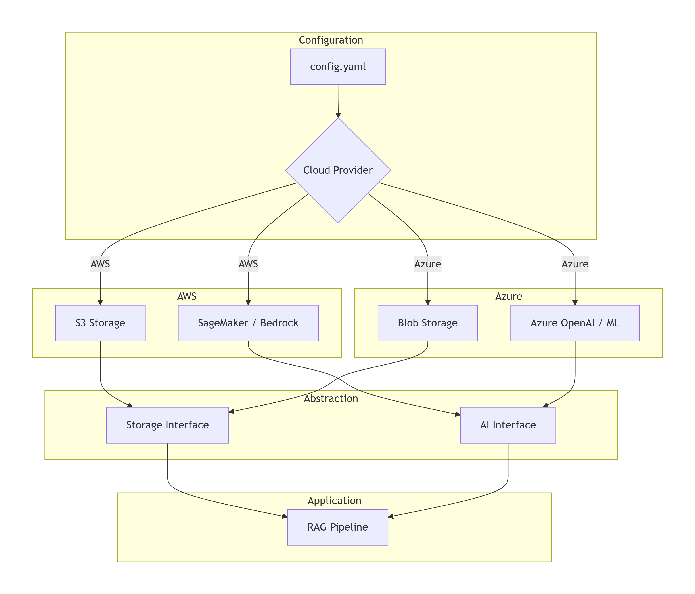
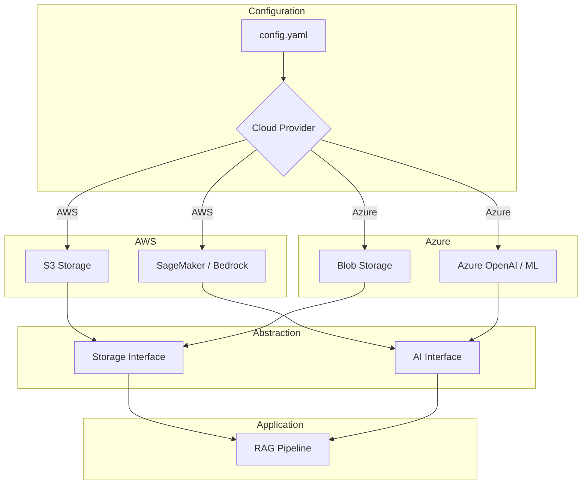

# Cloud-Agnostic AI Stack

A demonstration of how to build AI pipelines that can run on **AWS** or **Azure** with a single configuration file. The code abstracts cloud-specific APIs behind a common interface.

## Table of Contents
- [Overview](#overview)
- [Architecture](#architecture)
- [Features](#features)
- [Tech Stack](#tech-stack)
- [Prerequisites](#prerequisites)
- [Setup](#setup)
- [Usage](#usage)
- [Extending](#extending)
- [Troubleshooting](#troubleshooting)

---

## Overview

This project shows how to design an AI application that is **cloud-agnostic**. By using a configuration file and abstracting cloud services, the same code can be deployed on AWS or Azure without changes.

**Key aspects**:
- **Storage Abstraction**: S3 and Azure Blob have the same interface (upload, download, list).
- **AI Abstraction**: Bedrock (AWS) and Azure OpenAI are wrapped in a common client.
- **Config‑driven**: A single YAML file selects the provider and credentials.

---

## Architecture





---

## Features

- **Switch clouds** by changing `config.yaml`.
- **Abstract storage**: `StorageClient` works with S3 or Blob.
- **Abstract AI**: `AIClient` works with Bedrock or Azure OpenAI.
- **RAG pipeline** uses both abstractions to demonstrate end‑to‑end.
- **Terraform** templates for both clouds (optional).

---

## Tech Stack

| Component          | Technology                              |
|--------------------|-----------------------------------------|
| **Storage**        | boto3 (AWS), azure-storage-blob (Azure) |
| **AI**             | boto3 (Bedrock), openai (Azure OpenAI)  |
| **Configuration**  | PyYAML                                  |
| **Testing**        | pytest + mock                           |

---

## Prerequisites

- Python 3.10+
- Cloud credentials for AWS or Azure (depending on which you want to test)
- (Optional) Terraform installed for infrastructure provisioning

---

## Setup

### 1. Clone the Repository
```bash
git clone https://github.com/your-username/cloud-agnostic-ai-stack.git
cd cloud-agnostic-ai-stack
```

### 2. Create Virtual Environment
```bash
python -m venv venv
source venv/bin/activate  # On Windows: venv\Scripts\activate
```

### 3. Install Dependencies
```bash
pip install -r requirements.txt
```

### 4. Configure Cloud Credentials
- For **AWS**: Set `AWS_ACCESS_KEY_ID` and `AWS_SECRET_ACCESS_KEY` environment variables or configure via AWS CLI.
- For **Azure**: Set `AZURE_STORAGE_CONNECTION_STRING` and `AZURE_OPENAI_ENDPOINT` + `AZURE_OPENAI_KEY`.

### 5. Edit `config.yaml`
Choose your cloud provider and fill in the required resource names.

### 6. Run the Example
```bash
python src/main.py
```

---

## Usage

### Configuration File (`config.yaml`)
```yaml
cloud: aws   # or azure

storage:
  bucket_name: my-bucket   # for AWS
  container_name: my-container  # for Azure

ai:
  model_id: "amazon.titan-text-express-v1"  # AWS Bedrock
  # or for Azure:
  # deployment_name: "gpt-35-turbo"
  # endpoint: "https://my-openai.openai.azure.com/"
  # api_version: "2023-12-01-preview"
```

The `src/main.py` script demonstrates a simple RAG pipeline that:
1. Uploads a sample document (if not present)
2. Retrieves a relevant chunk
3. Generates an answer using the AI client

### Running with Different Clouds
- **AWS**: set `cloud: aws` in `config.yaml`, ensure AWS credentials are available.
- **Azure**: set `cloud: azure` and provide connection string and endpoint.

---

## Extending

To add a new cloud (e.g., GCP):
1. Create a new class in `storage.py` that inherits from `BaseStorage` and implements the required methods.
2. Create a new class in `ai_interface.py` that inherits from `BaseAI` and implements the required methods.
3. Update `config.py` to map the cloud name to the correct classes.

---

## Troubleshooting

| Problem | Solution |
|---------|----------|
| `ModuleNotFoundError` | Install missing packages: `pip install -r requirements.txt` |
| AWS permission errors | Check IAM permissions for S3 and Bedrock. |
| Azure authentication errors | Verify connection string and endpoint. |
| Config not found | Ensure `config.yaml` is in the working directory. |

---

## License

MIT
.
.
.
.
.
